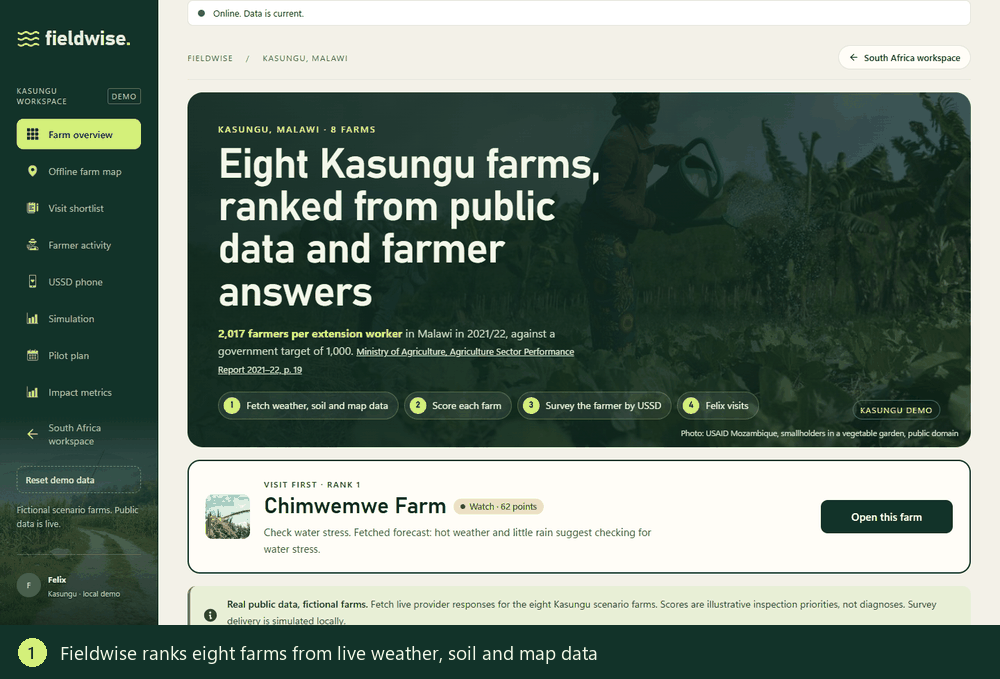
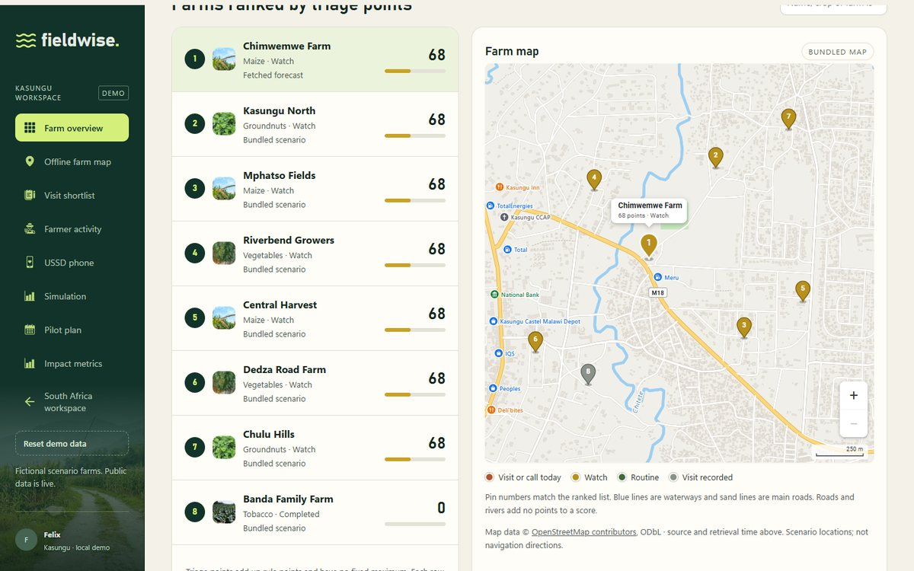
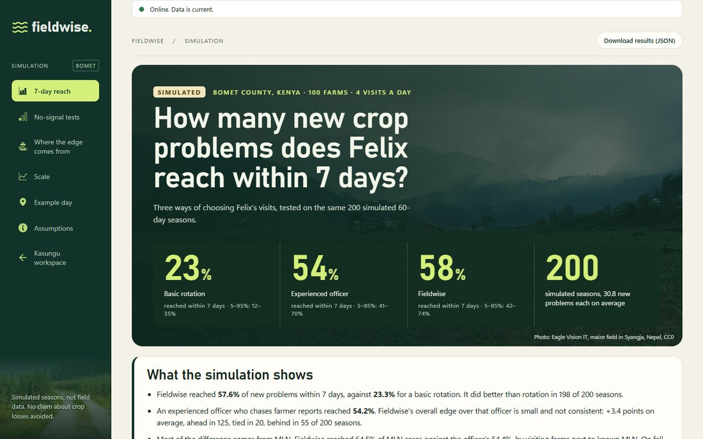
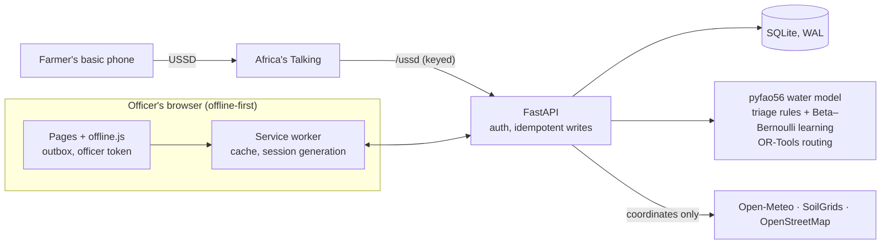

# Fieldwise

[](https://github.com/Kea-nhlapo/fieldwise/actions/workflows/tests.yml)
[](LICENSE)


An offline-first field app that tells an agricultural extension officer which farm to visit first, and shows why.



In 2021/22, Malawi had one extension worker for every 2,017 farmers, against a government target of 1,000 ([Ministry of Agriculture, *Agriculture Sector Performance Report 2021–22*, p. 19](https://docs.dcafs-tipdep-donors-mw.org/dt_docs/DOC20230126080437.pdf)). An officer can make a handful of visits a day. Fieldwise ranks farms using:
- live public data;
- short check-ins that farmers answer on a basic phone;
- what the officer found on earlier visits.

It keeps working with no signal.

*Hackathon project: the farms are fictional, and nothing has been validated in the field.*

## What's technically interesting

- **Offline-first with exactly-once sync.** A service worker caches the app. An outbox holds actions taken offline, and idempotency keys stop a retried action being saved twice. → [`static/sw.js`](static/sw.js), [`static/offline.js`](static/offline.js), the `offline_replay` middleware in [`fieldwise/app.py`](fieldwise/app.py)
- **Sign-out that actually locks a shared device.** Every signed-in request needs an HttpOnly cookie *and* a per-device token, so deleting the token signs the device out at once, even offline.
  - A "session generation" stops responses that were still downloading during sign-out from being cached or shown.
  - Sign-out reaches every open tab.
  - Seven browser scenarios cover the race conditions, including one that fails against the earlier implementation.

  → [`fieldwise/auth.py`](fieldwise/auth.py), [`scripts/signout-check.cjs`](scripts/signout-check.cjs)
- **Farmer check-ins over USSD.** The menus use [Africa's Talking's](https://africastalking.com) callback format, consent comes first, and the questions branch. Fuzz tests with 300+ malformed inputs never produce an error page. The gateway key is redacted from access logs. → [`fieldwise/ussd.py`](fieldwise/ussd.py)
- **Asking only where an answer changes the plan.** For each farm, Fieldwise scores both possible answers and surveys the farms whose answer would change today's visits. A Beta–Bernoulli model learns from visit outcomes how often each signal turns out to be real. → [`fieldwise/learning.py`](fieldwise/learning.py)
- **A simulation built to be falsifiable.** The design and expected results were committed to git before the first comparison ran. It includes an experienced-officer baseline, two no-signal controls, an ablation and a scale test, and it reports where Fieldwise loses. → [`fieldwise/simulation.py`](fieldwise/simulation.py), [`docs/SIMULATION.md`](docs/SIMULATION.md)

| Farm map, drawn offline from OpenStreetMap data | Simulation results page |
|---|---|
|  |  |

## Results, from simulation

7-day reach is the share of new pest or disease problems that get a visit within a week. Figures are from 200 seeded seasons: 100 farms around Bomet County, Kenya, with 4 visits a day.

| Scheduling rule | 7-day reach | Fall armyworm | Maize lethal necrosis |
|---|---|---|---|
| Basic rotation | 23% | 23% | 23% |
| Experienced officer (chases farmer reports) | 54% | 54% | 54% |
| **Fieldwise** | **58%** | 54% | **65%** |

- **Against basic rotation:** Fieldwise was ahead in 198 of 200 seasons.
- **Against the experienced officer, the edge is small:** ahead in 125 seasons, tied in 20, behind in 55. All of it comes from MLN, by following confirmed cases to neighbouring farms.
- **With every signal scrambled, the advantage disappears.**
- **At 250 farms per officer, Fieldwise trailed the officer.**

No claim is made about crop losses avoided.

## How it fits together



Python 3.12, FastAPI, SQLite in WAL mode, and plain HTML, CSS and JavaScript, with no build step. Three settings each show one part, and none is one system validated in one place:

| Setting | What it shows | Page |
|---|---|---|
| Kasungu, Malawi: 8 scenario farms | The officer workflow: timestamped evidence → explained priority → USSD survey → visit → learning | `/felix` |
| South Africa: 5 fictional maize farms | The crop water model and a farmer's "irrigation stopped" reply | `/` |
| Bomet County, Kenya: 100 simulated farms | The 7-day-reach simulation | `/simulation` |

## Run it

```bash
python -m venv .venv
.venv/Scripts/python.exe -m pip install -r requirements.txt   # Windows; use .venv/bin/python elsewhere
```

Then double-click **START-FIELDWISE.cmd** (or run `start.ps1`) and open http://127.0.0.1:8765. The launcher sets a demo officer PIN, **2468**, and prints it. A walkthrough with expected numbers is in [docs/DEMO-SCRIPT.md](docs/DEMO-SCRIPT.md).

With Docker:

```bash
docker build -t fieldwise .
docker run -p 8765:8765 -v fieldwise-data:/app/data -e FIELDWISE_OFFICER_PIN=<pin> fieldwise
```

## Tests

```bash
.venv/Scripts/python.exe -m unittest discover -s tests        # 96 tests
.venv/Scripts/python.exe scripts/serve-test.py --port 8769 --pin 2468   # disposable server for browser checks
node scripts/signout-check.cjs http://127.0.0.1:8769          # 7 sign-out and race scenarios
node scripts/pin-check.cjs http://127.0.0.1:8769              # sign-in, receipts, outbox after sign-in
node scripts/offline-a11y-check.cjs http://127.0.0.1:<open-server-port>   # offline install, sync, axe-core WCAG 2.1 AA
node scripts/record-demo.cjs http://127.0.0.1:<open-server-port>          # plays the whole demo
```

The browser checks use Playwright with Microsoft Edge. The unit tests run on every push (see the badge).

## Design decisions

- **Two credentials instead of one.** A cookie alone can't be revoked by a device that's offline. Pairing it with a token the device holds means signing out takes effect locally at once, and it blocks cross-site request forgery too.
- **SQLite in WAL mode.** With the default journal, a demo reset could fail with "database is locked" while a dashboard read was open. A regression test reproduces that failure without WAL.
- **No phone numbers stored.** USSD answers are tied to a farm number. Recognising callers by phone would remove a step but keep data derived from phone numbers; a farm code on each farmer's card is the proposed middle ground.
- **Impact numbers say what kind of number they are.** `/impact` separates measured outcomes, activity and labelled model estimates. Its event log holds no personal data, so counts survive a farmer's erasure request.

## Before a real pilot

- **USSD delivery:** provision a code with a provider and set `FIELDWISE_USSD_KEY`. Without it, the callback is off.
- **Tying a caller to a farm:** prove which farm a caller answers for, with a farm code on each farmer's card.
- **Offline data at rest:** encrypt cached records. Today they're deleted on sign-out but not encrypted.
- **Accounts:** per-officer accounts and an audit trail, instead of one shared PIN.
- **Validation:** test the thresholds and simulation rates in the field.
- **Data protection:** a compliance assessment under Malawi's Data Protection Act 2024 and South Africa's POPIA.

## Project structure

```
fieldwise/   FastAPI app: auth, USSD, triage and learning, simulation, impact metrics, storage
static/      Pages, offline layer (offline.js, sw.js), styles, icons, photos, bundled Kasungu data
tests/       Unit and API tests
scripts/     Browser checks, simulation runner, demo recorder, test server
docs/        Simulation, water model, offline and impact, evidence flow, design notes, demo script
```

## Licence and credits

Code is MIT-licensed (see [LICENSE](LICENSE)). The following keep their own terms:
- **Photos:** public domain or CC0 ([credits](static/photos/CREDITS.md)).
- **Icons:** Health Icons (CC0) and Lucide (ISC).
- **Data:** map data © OpenStreetMap contributors (ODbL), soil data from ISRIC SoilGrids (CC BY 4.0), weather from Open-Meteo.
- **Libraries:** [pyfao56](https://github.com/kthorp/pyfao56) and [OR-Tools](https://developers.google.com/optimization).
